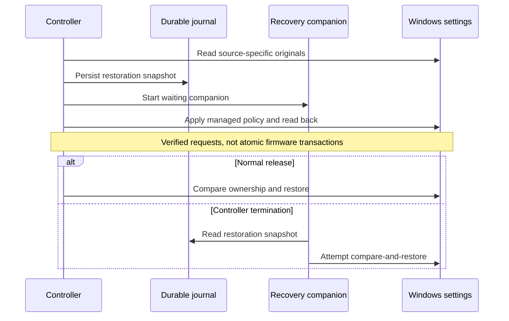

# Failure handling and ownership limits

The controller can write managed Windows settings; the recorder cannot. Hardware limits, fans, GPU mode and Curve Optimizer remain outside Pulse's actuator boundary.

| Condition | Implemented behavior | Limit / review point |
|---|---|---|
| Pause or AC bypass | Release owned source settings; stop ordinary active monitoring | G Helper's global Windows-mode handoff is not automatically reversed per charger event |
| Known tool open but idle | Require CPU-time evidence before Compute | Executable identity is candidate information only |
| Persistent host finishes internal work | Release through observed quiet | No universal task-complete event; sampling adds latency |
| Parent exits while children continue | Account for surviving tracked tree members | Discovery/access limits can leave unobserved work |
| Process ID reused | Check identity/creation time and native sequence where available | Fallback capabilities differ across Windows versions |
| Process unavailable or access denied | Bounded cache, denial backoff and evidence expiry | Missing evidence does not prove idle |
| Overlapping productive trees | Decide per tree, aggregate before final state choice | Unrelated media must not impose a global veto on a compiler |
| Power API/readback failure | Report fault and retain restoration information as applicable | Software acceptance cannot guarantee physical enforcement |
| Active plan inherits required values (Windows 50) | Refuse capture before any policy write; explain how to select Balanced and resume | Journal v3 cannot recreate absence of per-plan overrides; no silent plan replacement |
| Outside writer changes settings | Compare before restore; preserve distinguishable external choices | Identical values are indistinguishable; no cross-application atomic transaction |
| Controller terminates | Waiting companion attempts journal recovery | Not protection from simultaneous OS, storage or companion failure |
| OS crash/interrupted recovery | Best-effort recovery on a later launch | Requires an intact journal and functioning APIs |
| HWiNFO absent | Mark missing readings; required-sensor capture refuses startup | Battery-only data cannot establish package recovery |
| Shared writer busy/malformed data | Skip/reject snapshot; bounded parser checks | Synthetic tests do not replace live producer validation |
| Stale/gapped component evidence | Offline comparison rejects insufficient evidence | No interpolation invents rapid recovery |

## Recovery sequence

### Windows 50 during original-settings capture

On 22 September 2026, the active plan was the legacy High Performance scheme
(`8c5e7fda-e8bf-4a96-9a85-a6e23a8c635c`). Required processor settings were
inherited rather than explicitly present. `Power::capture` returned
`ERROR_NOT_SUPPORTED` (50) deliberately: the v3 recovery journal can restore
values, but cannot recreate inherited-only state after materializing an override.
This was not evidence of a failed disk write or a damaged preferences file.

After saving the preferences, diagnostics and original plan identity, local
recovery selected Balanced (`381b4222-f694-41f0-9685-ff5bb260df2e`) and restarted
Pulse. Runtime diagnostics confirmed Controlling, Armed, Efficiency, no fault,
DC boost 0, the efficiency overlay, and the user's 10% core / 25% processor
minimums. No preferences were reset. The installed error-message patch now
explains the plan incompatibility and directs the user to select Balanced, then
click Automatic; it does not automatically replace a newly selected plan.

Validation: the Release build passed all nine CTest checks. The installed
binary SHA-256 is
`63BAE9CF4C0E600E14B3C5ED22CBD7D0F70F06BAE7D5F27F4B0DBB3D3DFB0BC4`.
The previous executable and configuration were backed up before replacement;
the preferences hash was unchanged. Post-install runtime diagnostics again
showed Controlling, Armed, Efficiency and an empty Fault field. The inherited
plan rejection was observed before recovery; the automated checks do not
simulate every inherited-plan or registry-permission configuration.

Microsoft also documents the [power-mode slider's dependence on Balanced or a
Balanced-derived plan](https://learn.microsoft.com/en-us/windows-hardware/customize/desktop/customize-power-slider).
That compatibility requirement is separate from Pulse's journal-presence check:
a custom plan with missing explicit values can still fail capture. Do not
remove the check merely because `PowerRead*ValueIndex` returns an inherited
default. Proper general support requires a journal migration and exact
presence-aware restoration, or an explicitly owned temporary-plan lifecycle.

The journal checksum detects accidental corruption, not malicious same-user changes. Pulse is not a security boundary against other software running as that user. Direct hardware control is not a hidden fallback when Windows policy is insufficient. The separately opted-in 1.4 CPU-set actuator has its own identity/selection journal: recovery preserves different external selections and errors stop new placement. See [placement recovery](power-controls.md#optional-adaptive-scheduler).

There is no claim of exhaustive fault injection. Restore tests, source transitions and forced-exit observations are dated in [validation](validation.md); scenarios not rerun for 1.2 remain outstanding. Dynamic hardware limits need their own single-owner lease, partial-write handling, readback and crash/source-loss restoration. [SMU evaluation](smu-cap-evaluation.md).
